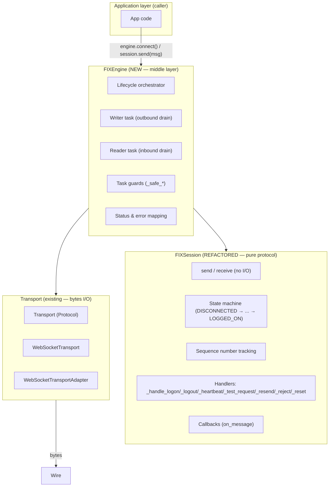
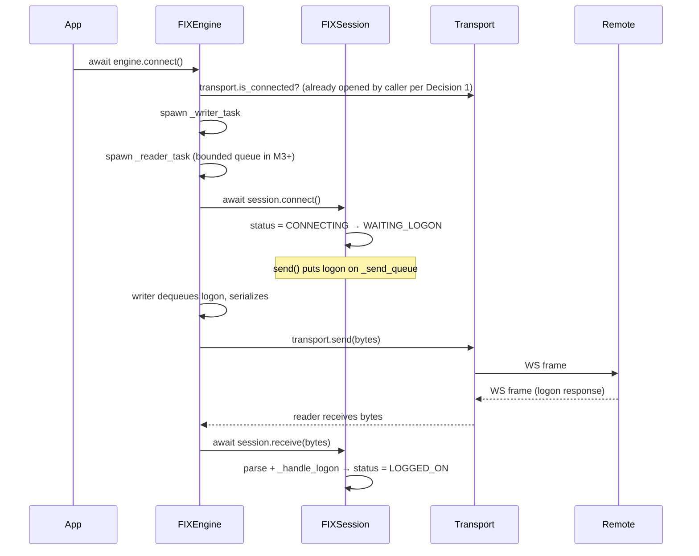
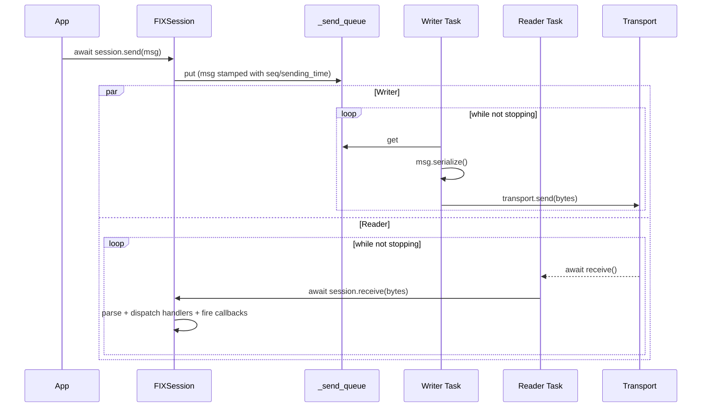
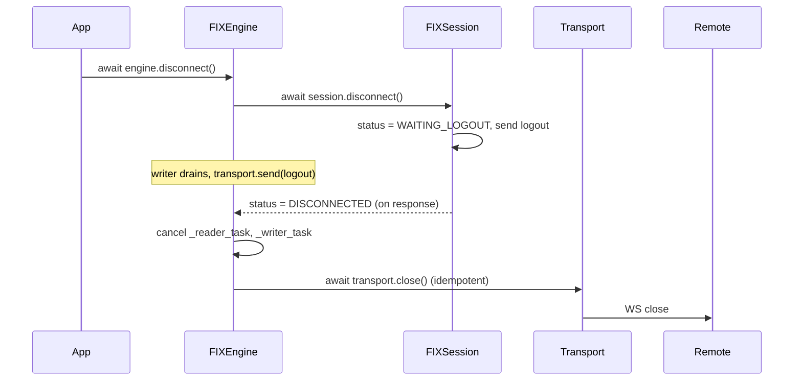
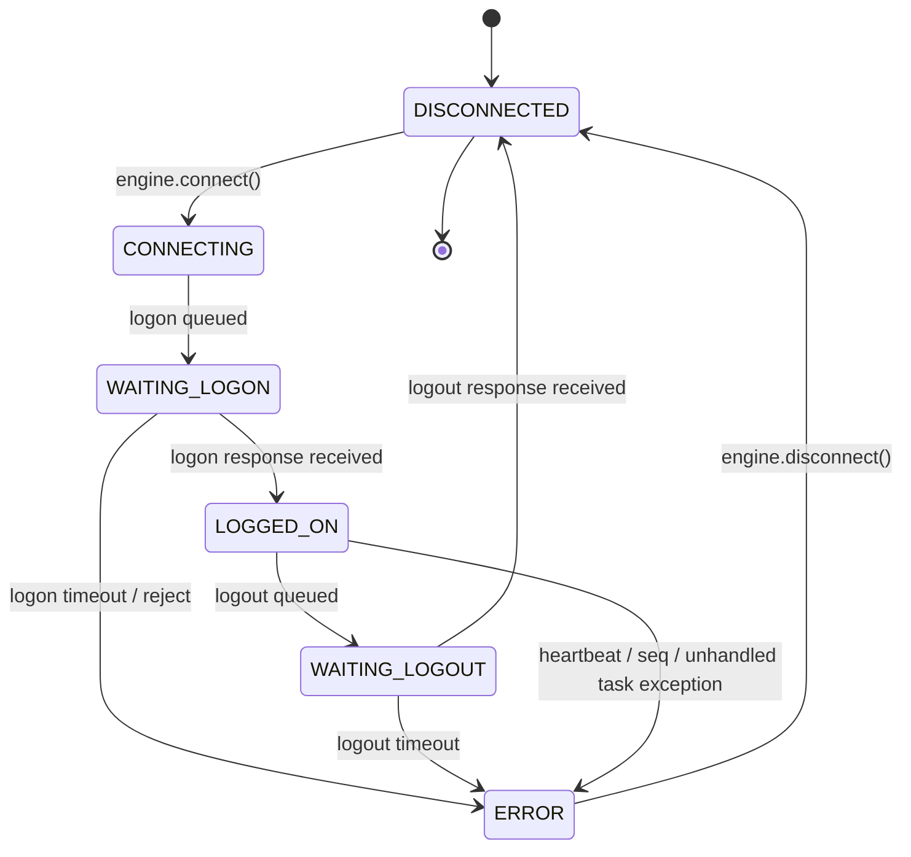

# Session × Transport Integration — Design

> **Status:** Architecture Decision Record for milestone M1 (see `MILESTONES.md`).
> **Owner:** FIXwire core.
> **Scope:** How the FIX protocol state machine connects to a Transport.

---

## 1. Context

### Problem

After M0 (`MILESTONES.md`), the codebase has two complete but unconnected layers:

- **Transport** (`src/fixwire/transport/`): `Transport` Protocol + `WebSocketTransport` (client), `WebSocketTransportAdapter` (server-side), `WebSocketServer`. Speaks raw bytes.
- **FIXSession** (`src/fixwire/core/session.py`): Full FIX protocol state machine — logon, logout, heartbeat, sequence management, message handlers, callbacks. Speaks `FIXMessage` objects.

The seam is missing:

- `FIXSession.send(msg)` puts a message on an internal `_send_queue` that nothing drains.
- `FIXSession.receive(raw)` parses bytes into messages but is only ever called by tests; nothing in the running system feeds it bytes.
- `FIXSession.connect()` updates state machine status but never opens a socket.
- `FIXSession.disconnect()` sends a logout but never closes a socket.

The result: the protocol brain is alive and the bytes highway is built, but no road connects them.

### Decision drivers

- **Production-grade target** (banking installable at V1.0).
- **Testability per layer.** Each layer must be provable in isolation; integration tests prove the wiring.
- **Protocol purity.** The FIX state machine must not know about sockets, bytes, or asyncio tasks. Bytes-in / bytes-out is not its concern.
- **Backpressure visibility.** A slow app must not cause memory blow-up or buffer overruns; the contract is observable.
- **Strict errors, recoverable.** Failures move the session to `ERROR` with a clean teardown. Retries are first-class, configurable, and obvious.

---

## 2. Architecture: Three Layers, One Coordinator



### Layer responsibilities

| Layer | Knows about | Does NOT know about |
|---|---|---|
| **Transport** | Sockets, frames, bytes | FIX semantics, seq numbers, sessions |
| **FIXSession** (refactored) | FIX messages, seq numbers, logon/heartbeat, callbacks | Sockets, bytes, asyncio tasks, transport |
| **FIXEngine** (new) | Transport, session, asyncio tasks, queue, lifecycle | FIX message semantics, internal handler details |

The protocol layer never imports `asyncio` for I/O scheduling; it uses `asyncio.Queue` for queueing because that's the only async-aware primitive it needs (and it's ergonomic to keep). Tasks live in `FIXEngine`.

---

## 3. The Four Locked Decisions

These are the decisions we committed to after working through the alternatives. Each is preserved here so future contributors do not relitigate them.

### Decision 1 — Transport ownership: caller injects into FIXEngine

**Choice:** `FIXEngine(session, transport)` receives a ready-to-use `Transport`. Caller does `await transport.connect()` first.

| Considered | Choice | Reason |
|---|---|---|
| A. Engine builds from URL | ❌ | Couples `FIXEngine` to URL semantics; harder to inject a fake for tests |
| **B. Caller injects** | ✅ | Pure injection; any `Transport` works; tests trivial |
| C. Both | ❌ for now | Two code paths to maintain; can revisit if a real convenience emerges |

### Decision 2 — Outbound model: writer task drains the queue

**Choice:** `FIXSession.send(msg)` queues the message; `FIXEngine` runs a writer task that dequeues, serializes, and `transport.send`s.

**Why not inline send:** the existing `tests/unit/core/test_session.py` pins the queue inside `FIXSession` via `session._send_queue.get_nowait()`. Removing it breaks tests; keeping it gives visible backpressure and a natural test affordance.

### Decision 3 — Inbound model: push with task guards

**Choice:** `FIXEngine` runs a reader task that loops `await transport.receive()` → `session.receive(bytes)`. The reader is wrapped in a `_safe_*` pattern that catches `Exception` (re-raises `CancelledError`), logs, and sets `session.status = ERROR`.

**Why not pull-only:** `receive()` would only fire when the caller asks, breaking the real-time semantics of FIX and forcing every consumer to implement their own polling loop.

**Why not bounded inbound queue at v1:** considered. The deciding constraint is FIX's absolute integrity invariant — **messages are never dropped** — so a full bounded queue can only block the reader (which is push with a larger buffer) or fail the session. Either way the queue is a latency shock absorber and a policy point, not a correctness mechanism; backpressure ultimately lands at the socket, where TCP slows the peer and no message is ever lost or reordered. Decision lands on **push with task guards** for M1 to keep the diff small while the engine itself is being invented. **The bounded inbound queue is a scheduled M3 deliverable** (queue-full policy: block with timeout → `ERROR`, never drop) — see the roadmap below.

### Decision 4 — Error handling: strict by default; retries configurable later

**Choice:**

- Any uncaught exception in a reader/writer task → log → `session.status = ERROR` → cancel sibling task → close transport.
- Foreground awaits (`session.send`, `engine.disconnect`) re-raise the relevant `ConnectionError` so the caller can react.
- Strict mode is on by default (M2 will codify this; today it is the parser's default).
- Retries with exponential backoff are deferred to M3. The signature is reserved: `engine.reconnect()` exists as a stub but does nothing until M3.

---

## 4. Naming

The choice of names reduces the ambiguity that bit us earlier:

| Concept | Name in code | Why |
|---|---|---|
| FIX protocol state machine | `FIXSession` | Already used; matches FIX spec terminology |
| Connection-level coordination | `FIXEngine` | Familiar in FIX community; "engine holds a session + transport" |
| Raw bytes I/O | `Transport` | Generic; the `Transport` Protocol enables TCP / WS / file / etc. |
| One FIX peer-to-peer relationship | "session" in conversation | When in doubt, talk about the *FIX session* (FIXSession) or the *engine* (FIXEngine) explicitly |

When something is **session-shaped** (logon, sequence, handlers), it belongs on `FIXSession`.
When something is **I/O-shaped** (tasks, queue, transport lifecycle), it belongs on `FIXEngine`.

---

## 5. Public API

### 5.1 `FIXSession` (refactored)

```python
class FIXSession:
    """Pure FIX protocol state machine — no I/O, no transport."""

    def __init__(self, config: SessionConfig) -> None: ...

    # --- Outbound ---
    async def send(self, msg: FIXMessage) -> None:
        """Stamp sender/target/seq/sending time and queue msg for outbound."""

    # --- Inbound ---
    async def receive(self, data: bytes) -> list[FIXMessage]:
        """Parse raw bytes, dispatch to handlers, return parsed messages."""

    # --- Callbacks ---
    def on_message(self, callback: Callable[[FIXMessage], Any]) -> None: ...

    # --- Introspection ---
    @property
    def status(self) -> SessionStatus: ...
    @property
    def is_connected(self) -> bool: ...
    def get_next_send_seq_num(self) -> int: ...
    def get_next_expected_seq_num(self) -> int: ...

    # --- Lifecycle hooks (used by FIXEngine, not normally called directly) ---
    async def connect(self) -> None: ...
    async def disconnect(self) -> None: ...
```

**Removed after refactor:**

- `_send_queue` *stays* (tests depend on it; the engine drains it).
- `_heartbeat_task` *moves* to `FIXEngine`.
- `_connect_task` *removed* (was unused).
- `_receive_callbacks` *stays* (used by engine's reader task path).

### 5.2 `FIXEngine` (new)

```python
class FIXEngine:
    """Coordinates a FIXSession with a Transport.

    Owns the asyncio tasks that move bytes in and out. Strict error handling:
    any uncaught task exception puts the session in ERROR and closes the transport.
    """

    def __init__(
        self,
        session: FIXSession,
        transport: Transport,
    ) -> None: ...

    # --- Lifecycle ---
    async def connect(self) -> None:
        """Open transport, spawn I/O tasks, run session logon."""

    async def disconnect(self) -> None:
        """Run session logout, stop tasks, close transport. Idempotent."""

    async def reconnect(self) -> None:
        """M1: raises NotImplementedError. Wired in M3."""

    # --- Introspection ---
    @property
    def status(self) -> SessionStatus:
        """Delegates to session.status."""

    @property
    def is_connected(self) -> bool:
        """Delegates to session.is_connected."""

    @property
    def session(self) -> FIXSession: ...
    @property
    def transport(self) -> Transport: ...
```

### 5.3 Transport (unchanged)

Already defined in `src/fixwire/transport/__init__.py` as a `Protocol`. No changes; implementations continue to be tested in isolation.

---

## 6. Data Flow

### 6.1 Connect



### 6.2 Steady state — message in/out



### 6.3 Disconnect



### 6.4 Error path

```mermaid
sequenceDiagram
    participant RT as Reader Task
    participant WT as Writer Task
    participant S as FIXSession
    participant T as Transport

    T-->>RT: await receive() raises ConnectionError
    RT->>RT: except (cancel sibling task: WT.cancel())
    RT->>S: session.status = ERROR
    RT->>T: await transport.close()
    Note over RT: task ends; engine surfaces ERROR status to caller
```

---

## 7. Lifecycle State Machine

(Owned by `FIXSession`, surfaced through `FIXEngine.status`.)



State transitions remain in `FIXSession`; `FIXEngine` only reads `session.status` and drives transitions via `session.connect()` / `session.disconnect()`.

---

## 8. Error Matrix

| Source | Where it surfaces | Strict mode action | Non-strict action | Session status |
|---|---|---|---|---|
| Transport connect refused | `engine.connect()` raises `ConnectionError` | n/a | n/a | stays `DISCONNECTED` |
| Transport dropped mid-session | Reader task catches | Log, set `ERROR`, cancel siblings, close transport | Same | `ERROR` |
| `FIXParseError` (bad checksum, malformed) | Inside `session.receive` | Raise → reader task catches → `ERROR` | Log + drop message | unchanged (non-strict) or `ERROR` (strict) |
| Sequence mismatch (M2) | Inside `session.receive` | Logout | Reject + continue (M2 fix) | unchanged or `ERROR` |
| Heartbeat timeout | `FIXEngine` heartbeat task | Logout (M2) | Same | `ERROR` |
| TestRequest timeout | `FIXEngine` heartbeat task | Disconnect (M2) | Same | `ERROR` |
| Logon timeout | `engine.connect()` awaits wait | Raise `TimeoutError` | Same | `ERROR` |
| Logout timeout | `engine.disconnect()` | Force close | Same | `DISCONNECTED` |
| Unhandled exception in task | Reader/Writer task `_safe_*` wrapper | Log, set `ERROR` | Same | `ERROR` |
| Caller-initiated `engine.disconnect()` while running | Engine | Cancel tasks, close transport | Same | `DISCONNECTED` |

The error matrix is enforced by tests: every row above maps to one or more named tests in M1 and M2.

---

## 9. M1 TDD Slicing

`MILESTONES.md` says M1 = Level A. Each slice has tests-first.

| # | Slice | Tests added |
|---|---|---|
| 1 | Refactor `FIXSession` to be transport-agnostic. No behavior change. | Existing `test_session.py` keeps passing. New negative tests: `FIXSession` constructor doesn't import or accept a `Transport`. |
| 2 | Add `FIXEngine` skeleton: constructor, `disconnect()` (no I/O yet), `status` / `is_connected` delegation. | Unit tests for `FIXEngine` with hand-rolled `FakeTransport`. |
| 3 | Writer task: drain `_send_queue`, serialize, `transport.send`. | Tests using `FakeTransport` with a recording `sent` list; deterministic. |
| 4 | Reader task: `transport.receive()` → `session.receive(bytes)`; `_safe_*` error guard. | Test injecting a `FIXMessage`-producing fake transport. Test where the fake transport raises to verify `ERROR` is set. |
| 5 | Lifecycle: `engine.connect()` orchestrates everything. `engine.disconnect()` cancels + closes. | Unit tests with fake transport. **`assertLogged` for state transitions.** |
| 6 | Real WebSocket integration test (one happy path): two sessions over `WebSocketServer` complete a Logon → Heartbeat → Logout. | New file `tests/integration/test_session_over_websocket.py`. Requires a free port — sandbox cannot bind; user's machine can. |

Each slice is its own commit on `feature/session-transport-integration`. CI must be green at each merge point.

---

## 10. Roadmap Considerations (For Future Milestones)

These are intentionally **out of scope for M1** but documented so M2+ contributors pick them up cleanly.

### M2 — Protocol hardening (sequence verify, heartbeat timings, reject)
- Incoming sequence verify inside `session.receive`.
- Heartbeat timing 1.2× interval per FIX 4.4.
- TestRequest strict timeout → `ERROR`.
- Reject / GapFill semantics per spec.
- `datetime.utcnow()` → `datetime.now(UTC)` migration.

### M3 — Resilience (reconnect, persistence, audit)
- `FIXEngine.reconnect()` with exponential backoff.
- `SequenceStore` protocol; `FileSequenceStore` default.
- Bounded inbound queue — scheduled deliverable. Queue-full policy: block with timeout → `ERROR`, never drop.
- App callback isolation: `on_message` must never block protocol handling (heartbeat/TestRequest responses); hand off to its own task.
- Audit logging spec.

### M4 — Security (WSS, mTLS, no-secret logs)
- `wss://` first-class in `WebSocketTransport`.
- Client cert auth (mutual TLS).
- Log audit checklist.
- Error message review checklist.

### M5 — Full resend
- Persistent outbox.
- Resend real original messages (replacing today's GapFill placeholder).

### M6 — Conformance
- Accept-session role (server-side).
- `docs/FIX44_CONFORMANCE.md` requirement ↔ test matrix.
- Test level raised to C.

---

## 11. Why This Shape, In One Paragraph

`FIXSession` does what FIX engines have always done: it tracks the protocol state machine. Removing I/O from it makes the protocol provable in isolation, which is what banking customers will demand. The cost of one new class (`FIXEngine`) is small; the benefit is that every cross-layer concern — when the transport opens, when tasks start, when bytes flow in, when bytes flow out, when errors move status to `ERROR` — lives in exactly one place, with one set of tests. The Transport Protocol keeps `FIXEngine` socket-agnostic; today's WebSocket slots in, tomorrow's TCP or HTTP/2 slots in identically. The user-facing API (`engine.connect`, `engine.disconnect`, callbacks on the session) stays the friendly shape people expect from a FIX engine.
